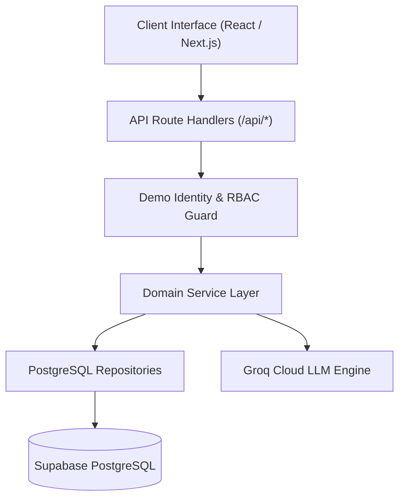
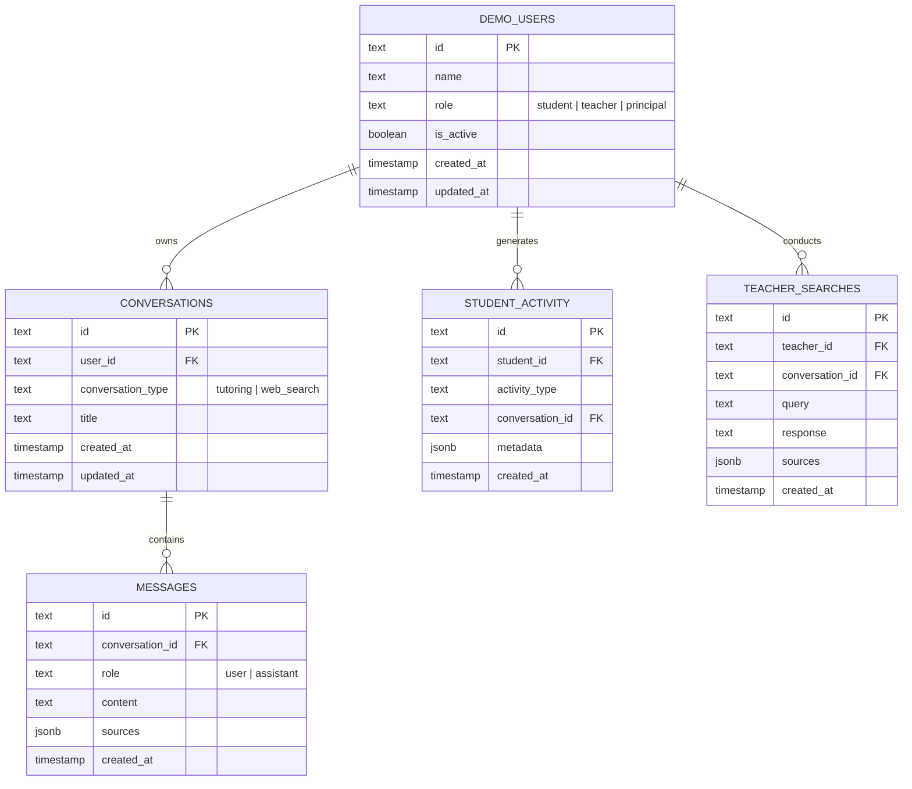
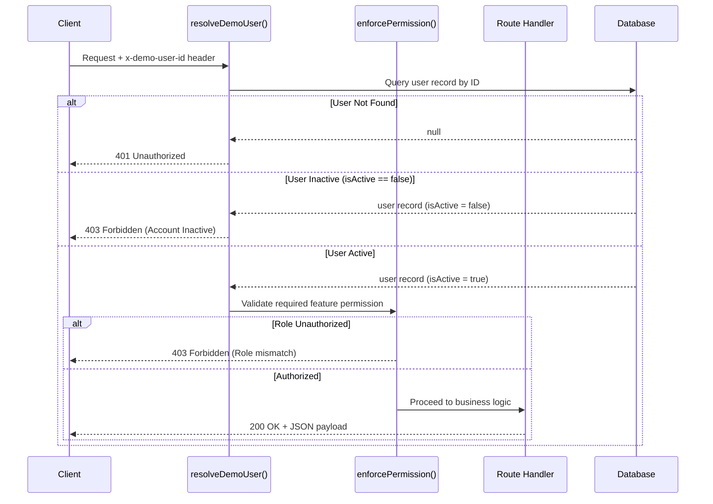

# Architecture & System Design Specification

## 1. System Overview

Dumroo.ai is an educational AI intelligence platform engineered with Next.js App Router, TypeScript (strict mode), Drizzle ORM targeting Supabase PostgreSQL, and Groq SDK. The platform enforces strict role-based access control (RBAC) across three distinct educational roles: Student, Teacher, and Principal / Admin.



---

## 2. Directory Structure

```text
Dumroo.ai/
├── drizzle/                          # Drizzle PostgreSQL migration SQL & snapshots
│   ├── meta/                         # Snapshot metadata
│   └── 0000_keen_mandarin.sql        # Core database schema migration
├── scripts/
│   └── verify-backend.ts             # Direct end-to-end backend integration tests
├── src/
│   ├── app/
│   │   ├── api/
│   │   │   ├── activity/             # Student event telemetry endpoint
│   │   │   ├── conversations/        # Conversation lifecycle and message threads
│   │   │   ├── current-user/         # Active identity resolver
│   │   │   ├── demo-users/           # Seeded demo persona listing
│   │   │   ├── monitoring/           # Student, Teacher, and Overview telemetry
│   │   │   ├── search/               # Groq educational web search & scoped history
│   │   │   └── tutor/                # Socratic AI tutoring endpoint
│   │   ├── globals.css               # Base Tailwind theme and ambient gradients
│   │   ├── layout.tsx                # Root layout with DemoUserProvider
│   │   └── page.tsx                  # Unified responsive workspace with role views
│   ├── components/
│   │   ├── principal/
│   │   │   ├── PrincipalOverview.tsx         # Platform-wide telemetry & KPI metrics
│   │   │   ├── PrincipalTeacherMonitor.tsx   # Faculty monitoring data table
│   │   │   └── TeacherDetailModal.tsx        # Faculty inquiry audit popup
│   │   ├── shared/
│   │   │   ├── ChatMessageView.tsx           # Styled chat message bubble component
│   │   │   ├── DumrooChatInput.tsx           # Pill input with Grade and Subject filters
│   │   │   ├── DumrooLogo.tsx                # Brand SVG emblem and typography
│   │   │   ├── FormattedAiContent.tsx        # Structured Markdown & table parser
│   │   │   ├── Navbar.tsx                    # Direct role switcher & user dropdown
│   │   │   └── SourceCards.tsx               # Verified clickable citation cards
│   │   ├── student/
│   │   │   └── StudentTutorView.tsx          # Socratic tutoring chat & session history
│   │   └── teacher/
│   │       ├── StudentDetailModal.tsx        # Student conversation & activity audit modal
│   │       ├── TeacherSearchView.tsx         # Educational web search canvas
│   │       └── TeacherStudentMonitor.tsx     # Student engagement monitor table
│   ├── contexts/
│   │   └── DemoUserContext.tsx       # Client-side user persona state & cookie sync
│   ├── lib/
│   │   ├── ai/
│   │   │   ├── groq.ts               # Groq SDK client singleton & model configuration
│   │   │   ├── search.service.ts     # Web search pipeline & source extraction
│   │   │   └── tutor.service.ts      # Socratic pedagogical prompt pipeline
│   │   ├── auth/
│   │   │   └── demo-user.ts          # Server-side identity resolution & active check
│   │   ├── db/
│   │   │   ├── connection.ts         # Supabase PostgreSQL client connection pool
│   │   │   ├── index.ts              # Database client and schema re-exports
│   │   │   ├── load-env.ts           # Automatic .env.local loader for CLI & scripts
│   │   │   ├── migrate.ts            # Drizzle PostgreSQL migration runner
│   │   │   ├── schema.ts             # Strict Drizzle PostgreSQL relational schema
│   │   │   └── seed.ts               # Seed data for demo personas & initial records
│   │   ├── permissions/
│   │   │   └── access-control.ts     # Role Permission Matrix & guard functions
│   │   ├── repositories/
│   │   │   ├── activity.repository.ts       # Student activity repository
│   │   │   ├── conversation.repository.ts   # Chat conversation repository
│   │   │   ├── index.ts                     # Repository exports
│   │   │   ├── interfaces.ts                # Strong domain repository contracts
│   │   │   ├── message.repository.ts        # Chat messages repository
│   │   │   ├── monitoring.repository.ts     # Administrative monitoring queries
│   │   │   ├── search.repository.ts         # Teacher & Principal searches
│   │   │   └── user.repository.ts           # Demo users repository
│   │   ├── utils/
│   │   │   ├── api-response.ts       # Standardized API response envelopes
│   │   │   ├── error-handler.ts      # Global exception & Zod error handling
│   │   │   └── rate-limiter.ts       # In-memory per-user rate limiter
│   │   ├── validations/
│   │   │   └── schemas.ts            # Zod validation schemas for all requests
│   │   └── api-client.ts             # Client-side authenticated fetch wrapper
│   └── types/
│       ├── api.ts                    # Request/Response data payloads
│       ├── database.ts               # Entity interfaces matching SQL schemas
│       └── index.ts                  # Central type export
├── drizzle.config.ts                 # Drizzle Kit configuration for PostgreSQL
├── next.config.ts                    # Next.js configuration
├── package.json                      # Dependency manifests & migration scripts
└── tsconfig.json                     # TypeScript strict configuration
```

---

## 3. Database Layer Architecture

The database architecture is built 100% on PostgreSQL, hosted on Supabase and managed using Drizzle ORM.

### Connection & Pooling Architecture

- Client library: `postgres.js` with Drizzle ORM `drizzle-orm/postgres-js`.
- URL Sanitization: The connection utility cleans the connection string by removing the `pgbouncer=true` parameter. Because `postgres.js` treats URL query parameters as server startup parameters, stripping this prevents fatal connection rejections on Supabase transaction poolers.
- Transaction pooling: The application pool uses `prepare: false` to be fully compatible with Supabase PgBouncer poolers on port 6543.
- Migrations: Drizzle Kit migrations target the direct database port (5432) via `DIRECT_URL` to support schema DDL operations.

### Data Model



---

## 4. Security & Role-Based Access Control (RBAC)

Authentication uses database-verified demo identities transmitted via the `x-demo-user-id` HTTP header or `demo_user_id` cookie. Client-side role claims are discarded.

### Verification Flow



### Server-Side Permission Matrix

| Feature | Student | Teacher | Principal | Enforcement |
|---|:---:|:---:|:---:|---|
| **AI Tutoring** | Allowed | Forbidden (403) | Forbidden (403) | `POST /api/tutor` |
| **Web Search** | Forbidden (403) | Allowed | Allowed | `POST /api/search` |
| **Search History** | Forbidden (403) | Own searches only | Platform-wide / Filterable | `GET /api/search/history` |
| **Student Activity Monitor** | Forbidden (403) | Allowed | Allowed | `GET /api/monitoring/students` |
| **Student Session Audit** | Forbidden (403) | Allowed | Allowed | `GET /api/conversations?userId=` |
| **Teacher Activity Monitor** | Forbidden (403) | Forbidden (403) | Allowed | `GET /api/monitoring/teachers` |
| **Platform Overview** | Forbidden (403) | Forbidden (403) | Allowed | `GET /api/monitoring/overview` |

---

## 5. AI Engine & Prompt Pipeline

### Socratic Tutoring Pipeline (`src/lib/ai/tutor.service.ts`)
- Configured with a system prompt mandating step-by-step hints and guided questioning rather than immediate answers.
- Automatically injects the previous 15 messages of conversation context.
- Automatic Model Failover: If `openai/gpt-oss-20b` reaches rate limits (HTTP 429), the service automatically switches to `openai/gpt-oss-120b` seamlessly.

### Educational Web Search Pipeline (`src/lib/ai/search.service.ts`)
- Utilizes Groq tool execution with `browser_search`.
- Synthesizes findings into Executive Summary, Pedagogical Insights, and Classroom Recommendations.
- Extracts citation metadata into normalized `SearchSource[]` objects containing authentic URLs, titles, and snippets.
- Fallback Resilience: If tool execution encounters payload limits, the service falls back to structured pedagogical research synthesis.

---

## 6. Frontend Architecture & Output Sanitization

### Unified Workspace (`src/app/page.tsx`)
- Top-level segmented controller allows instant role switching.
- Views are separated by active role.
- All network requests automatically attach `x-demo-user-id` via `src/lib/api-client.ts`.

### AI Content Sanitization (`src/components/shared/FormattedAiContent.tsx`)
LLM responses frequently output Markdown dividers (`***`, `---`) or raw ASCII table pipes (`| ... |`). The `FormattedAiContent` engine cleans and formats these structures:
1. Strips repetitive horizontal asterisks dividers.
2. Converts Markdown tables into Tailwind data tables with borders and header backgrounds.
3. Formats educational callouts (Hints, Strengths, Key Insights) into colored callout cards.
4. Renders bullet lists with clean indentation and custom bullet indicators.

---

## 7. Key Architectural Decisions

1. **Unified PostgreSQL Repository Pattern**: Repositories directly implement domain contracts (`IUserRepository`, `IConversationRepository`, `ISearchRepository`, etc.) against PostgreSQL via Drizzle ORM, keeping the code simple, predictable, and easy to explain.
2. **Stateless In-Memory Rate Limiting**: Per-user sliding-window rate limiters prevent runaway prompt loops without introducing Redis or external infrastructure overhead.
3. **No Network Font Dependency**: System font fallbacks are used to guarantee that Next.js compilation succeeds in isolated or restricted sandbox environments without external font timeouts.
4. **Strict Isolation of Teacher Inquiries**: In `/api/search/history`, queries executed by teachers are filtered strictly by `teacherId = user.id`. Teachers cannot query or inspect searches conducted by other teachers or the principal.
